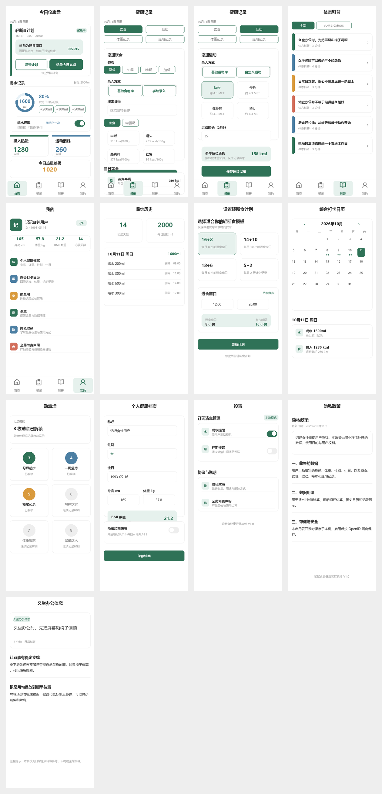

# 记记食钟微信小程序 V1.0

软著建议名称：记记食钟健康管理软件 V1.0

项目采用微信原生小程序 + 微信云开发。默认运行在本地存储模式，未部署云函数也可完整演示 V1 的记录、统计、日历、勋章、科普和协议页面。

## 项目预览



单页效果图位于 `docs/screenshots/`，包括首页、记录、运动、科普、个人中心、日历、喝水历史、档案、设置和协议页面。

## 已实现功能

- 首页今日仪表盘：断食时间轴、实时倒计时、每日断食打卡、喝水环形进度、摄入热量、运动消耗、热量差额。
- 自定义底部导航：首页、记录、科普、我的四项使用大图标、大字号、选中底色和顶部指示条。
- 统一 UI 规范：375px 竖屏、全屏流式布局、8px 安全边距、固定主色与辅助色、12px 卡片圆角、44px 主按钮。
- 轻断食计划：16+8、14+10、18+6、5+2 模板，自定义进食开始与结束时间，首次进入强制健康风险确认，支持随时停止和重新启用。
- 饮食记录：早餐、午餐、晚餐、加餐分类，基础食物库和手动热量录入。
- 饮食录入增强：支持食物名称搜索、复制昨日饮食、填写克数或碗数自动计算热量。
- 运动记录：快走、慢跑、跳绳、瑜伽、健身操、骑行等基础运动库，按档案体重和时长估算消耗，支持自定义运动。
- 体重记录：体重录入、BMI 数值展示、最近记录趋势折线图。
- 喝水记录：1500 至 2500ml 目标，200/300/500ml 快捷打卡，环形进度展示。
- 喝水历史与提醒：首页可撤销最近一次喝水记录，历史页可逐条删除，并支持订阅消息授权。
- 经期记录：起止日期、平均周期、下次经期及排卵日简单估算、一键隐藏模块。
- 体态科普：久坐办公体态、站姿习惯、居家简易拉伸，共 6 篇图文文章。
- 我的：健康档案、综合打卡日历、勋章墙、订阅提醒设置、记录清理、隐私政策、全局免责声明。
- 云开发：按 OpenID 隔离数据，支持读取、保存、清理记录。
- 订阅消息：用户主动授权，云函数定时检查并发送喝水、经期提醒。

## 项目结构

```text
jijishizhong/
├─ miniprogram/                 小程序前端
│  ├─ config/                   云环境、订阅模板、演示开关
│  ├─ data/                     断食模板、食物库、运动库、科普文章
│  ├─ pages/                    12 个页面
│  └─ utils/                    日期、计算、存储、云同步等工具
├─ cloudfunctions/
│  ├─ login/                    获取 OpenID
│  ├─ health/                   健康记录数据云函数
│  └─ sendReminders/            订阅消息定时提醒
├─ docs/                        部署、测试、软著和合规资料
│  └─ screenshots/              UI 效果图
├─ scripts/validate.js          零依赖静态校验脚本
├─ .github/workflows/validate.yml GitHub Actions 校验
└─ project.config.json          微信开发者工具项目配置
```

## 导入运行

1. 打开微信开发者工具，选择“导入项目”。
2. 项目目录选择本仓库根目录，即包含 `project.config.json` 的目录。
3. 首次体验可以保留 `touristappid`，或在微信公众平台创建小程序后换成真实 AppID。
4. 编译后默认使用本地存储，可直接操作所有记录功能。
5. 运行静态校验：

```powershell
npm test
powershell -ExecutionPolicy Bypass -File scripts/compile-wechat.ps1
```

## 上传 GitHub

仓库已经包含 `.gitignore` 和 GitHub Actions。创建远程仓库后执行：

```powershell
git remote add origin <你的仓库地址>
git push -u origin main
```

涉及真实 AppID、云环境 ID、订阅模板 ID 时，请先确认是否适合公开。微信云开发密钥不要提交到仓库。

## 启用云开发

1. 在微信开发者工具中开通云开发环境。
2. 创建数据库集合：`health_profiles`。
3. 将集合权限设置为仅云函数可读写，前端数据统一通过 `health` 云函数访问。
4. 在开发者工具中分别右键 `login`、`health`、`sendReminders`，选择“上传并部署：云端安装依赖”。
5. 编辑 `miniprogram/config/index.js`：

```js
cloudEnabled: true,
cloudEnv: '你的云环境 ID',
```

6. 在云函数 `sendReminders` 中配置环境变量：

```text
WATER_TEMPLATE_ID=喝水订阅消息模板 ID
PERIOD_TEMPLATE_ID=经期订阅消息模板 ID
```

7. 将相同模板 ID 填入 `miniprogram/config/index.js` 的 `subscriptionTemplates`。

详细步骤见 `docs/云开发部署.md`。

## 演示数据

软著截图前，将 `miniprogram/config/index.js` 中的 `demoDataEnabled` 改为 `true`，进入“我的-设置-开发辅助”，点击“生成演示数据”。截图完成后应执行“清除全部记录”，并在正式发布前将开关改回 `false`。

可执行以下脚本重新生成软著材料草案：

```powershell
python scripts/generate-copyright-docs.py
```

生成文件位于 `docs/generated/`：

- `记记食钟健康管理软件V1.0-软件说明书草案.docx`
- `记记食钟健康管理软件V1.0-源程序前后60页草案.docx`

## 合规边界

- 全产品仅做数据记录与统计展示，不提供医疗诊断或疗效承诺。
- 断食首次使用强制健康风险确认。
- 热量、运动消耗、BMI 均只展示数值，不评价饮食好坏或体型。
- 经期和排卵日期只表述为预估参考。
- 所有科普文章末尾带统一免责声明。
- 订阅提醒必须由用户主动授权，小程序不支持后台常驻定时推送。
- 上线类目建议选择“生活服务-健康养生工具”，不要选择医疗类目。

## 软著资料

- `docs/软件著作权申请材料清单.md`
- `docs/演示截图清单.md`
- `docs/测试用例.md`
- `docs/合规文案核对.md`
- `docs/UI设计规范.md`
- `docs/generated/` 下的软件说明书和源程序草案
- `COPYRIGHT.md`

软著源码、说明书排版和申请表要求可能调整，正式提交前以中国版权保护中心及当地受理机构当期要求为准。
"# jijishizhong" 
